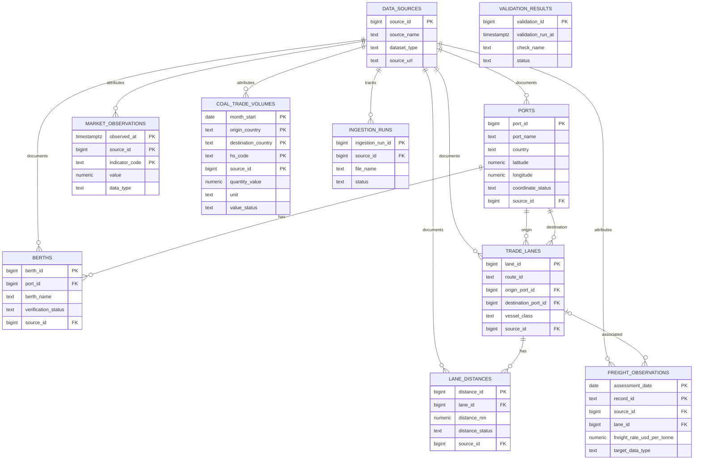

# Database schema, relationships, and safe recreation

## Included database assets

- [`sql/001_schema.sql`](sql/001_schema.sql): PostgreSQL/TimescaleDB base schema.
- [`sql/002_seed_berths_research.sql`](sql/002_seed_berths_research.sql):
  research-stage berth source/records; berth rows remain partially verified.
- [`sql/003_extend_derived_distance_proxies.sql`](sql/003_extend_derived_distance_proxies.sql):
  reuses existing same-port-pair proxies without upgrading their status.
- [`docker-compose.yml`](docker-compose.yml): local TimescaleDB service and
  first-volume schema initialization.

The `coal_trade_volumes` table is created by
[`ingest_coal_trade_volumes.py`](../08_Code_and_Handover/scripts/ingest_coal_trade_volumes.py)
using `CREATE TABLE IF NOT EXISTS`; it is not defined in `001_schema.sql`.

## ER diagram

The source is Mermaid and can be rendered by Markdown viewers that support
Mermaid. No screenshot or rendered diagram image is included.

`VALIDATION_RESULTS` is intentionally independent: each check execution is a
record with status, observed/expected values, and evidence. The diagram shows
the coal table's composite key as represented by the importer; see the actual
table definition in the included importer for all columns and constraints.

## Relationship notes

- `ports` has zero or more `berths`; each berth belongs to one port.
- `trade_lanes` references an origin and destination port, plus optional source
  metadata. Current lanes are candidate route scenarios.
- A lane may have one or more `lane_distances`; current rows are all derived
  proxies, not verified navigational sailing distances.
- `freight_observations` may reference a lane and must reference a source.
  Its primary key is `(assessment_date, record_id)`.
- `market_observations` references a source and is keyed by
  `(observed_at, source_id, indicator_code)`.
- Coal rows reference a source. The importer defines a composite primary key
  over month, origin, destination, HS code, and source.
- `data_sources` records provenance for multiple domain tables. `ingestion_runs`
  track files and outcomes; `validation_results` records check outcomes.

## Safe setup / recreation procedure

This documents how to initialize a **new local development database**. It does
not rebuild the current database, and no reset was performed for this
submission.

1. Use a disposable/new local checkout and confirm the target is an empty
   database volume. Do not run `docker compose down -v`, delete a volume, drop
   tables, or replay schema into an existing installation without a reviewed
   migration plan.
2. From the project root, copy `.env.example` to `.env` and set unique local
   placeholders/secrets privately. Never include `.env` in a submission.
3. Install Docker Compose v2 and the Python dependencies as described in
   [handover setup](../08_Code_and_Handover/README.md).
4. Run `docker compose up -d` and wait for the service health check. Compose
   mounts `001_schema.sql` into the initialization directory; the database
   image executes it only when initializing an empty data directory.
5. After confirming the initialized schema, use the ingestion order in the
   handover guide. The coal importer creates its own table when absent.
6. Review optional SQL seeds/migrations (`002` and `003`) before applying to a
   new database. They are transaction-wrapped and scoped to inserts/upserts,
   but their source values still require review.
7. Run validation only when prepared to persist validation records: the Python
   validation script inserts rows into `validation_results`.

On the existing project database, `docker compose up -d` merely starts the
service. It does not initialize/migrate an existing volume. Use a backup and
explicit migration procedure before any schema change.
